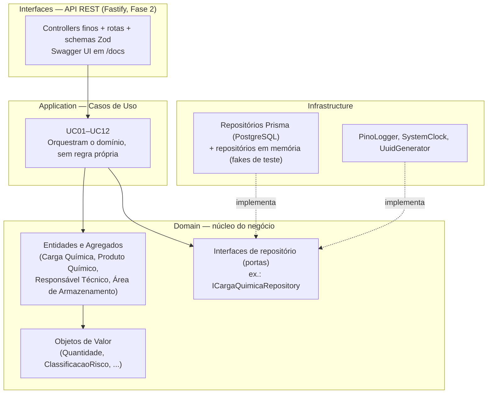

# Arquitetura — QuimiPort

> **Histórico de alterações:** revisado na Fase 2 (ADR-04, ADR-09, ADR-11) — a camada `Interfaces` deixou de estar "reservada para próximas fases": `interfaces/http/` existe de fato (Fastify), assim como `infrastructure/persistence/prisma/` ao lado dos repositórios em memória (mantidos como fakes de teste). A árvore de pastas na seção abaixo é a real, não mais a proposta da Fase 1.

Este documento cobre a arquitetura proposta para o QuimiPort e a organização inicial de pastas/responsabilidades. As justificativas de cada decisão (por que separar em camadas, por que TypeScript, como evoluir) ficam em [`decisoes-arquiteturais.md`](decisoes-arquiteturais.md); a ideia aqui é descrever **como** a arquitetura se estrutura.

## Estilo arquitetural

Optamos por uma **arquitetura em camadas inspirada em Clean Architecture / Ports & Adapters, com DDD tático concentrado no núcleo do domínio**. Essa escolha decorre diretamente do que já foi modelado em [`dominio.md`](dominio.md) e [`regras-de-negocio.md`](regras-de-negocio.md): as regras de negócio (RN01–RN13) vivem como invariantes dentro dos agregados (`Carga Química`, `Produto Químico`, `Responsável Técnico`, `Área de Armazenamento`), e a arquitetura basicamente formaliza onde cada peça do sistema se encaixa em torno desse núcleo.

Quatro camadas, com dependência sempre apontando para dentro (em direção ao domínio):

| Camada | Responsabilidade | Depende de |
|---|---|---|
| **Interfaces** (apresentação) | Pontos de entrada do sistema (API REST, CLI, futura Web/mobile). Traduz requisições externas em chamadas aos casos de uso. | Application |
| **Application** (aplicação) | Implementa os casos de uso (UC01–UC12 de [`casos-de-uso.md`](casos-de-uso.md)): orquestra o domínio, não contém regra de negócio própria. | Domain |
| **Domain** (domínio) | Entidades, agregados, objetos de valor, regras de negócio (invariantes) e as interfaces (portas) de repositório. Não depende de nenhuma outra camada. | — |
| **Infrastructure** (infraestrutura) | Implementações concretas das portas definidas no domínio: persistência (nesta fase, em memória), futuras integrações externas. | Domain (implementa suas interfaces) |

## Diagrama de arquitetura em camadas



**Regra de dependência:** 
- setas sólidas indicam "depende de"; 
- setas pontilhadas indicam "implementa a interface de". 
- Note que `Domain` não tem nenhuma seta saindo dele em direção a outra camada — é o centro da arquitetura e por isso pode ser testado isoladamente, sem banco de dados, sem framework web, sem infraestrutura nenhuma. Já `Infrastructure` depende do `Domain` (implementa suas interfaces), e não o contrário. É essa inversão que permite trocar a persistência em memória por um banco real, nas próximas fases, sem mexer em uma linha sequer de regra de negócio.

## Organização de pastas

Estrutura real a partir da Fase 2 (substitui a árvore proposta na Fase 1):

```
quimiport/
├── .github/workflows/ci.yml
├── docker/postgres/init.sql
├── docs/
│   ├── api/openapi.json                    # exportado via `npm run openapi:export`
│   ├── diagramas/
│   └── ...
├── prisma/{schema.prisma, migrations/, seed.ts}
├── generated/prisma/                        # client Prisma gerado (gitignored)
├── src/
│   ├── main.ts                              # bootstrap (lê env, monta container, inicia o servidor)
│   ├── container.ts                         # composição manual dos casos de uso (sem container de DI)
│   ├── domain/
│   │   ├── carga-quimica/                   # agregado raiz — igual à Fase 1, + regras.ts, transicoes.ts
│   │   ├── produto-quimico/
│   │   ├── responsavel-tecnico/
│   │   └── area-armazenamento/              # modelado, sem endpoint na Fase 2
│   ├── application/
│   │   ├── IUseCase.ts
│   │   ├── ports/ {IClock.ts, IIdGenerator.ts, ILogger.ts}
│   │   └── use-cases/ {carga-quimica/, produto-quimico/, responsavel-tecnico/}
│   ├── infrastructure/
│   │   ├── config/env.ts                    # Zod valida as env vars
│   │   ├── logging/PinoLogger.ts
│   │   ├── persistence/
│   │   │   ├── in-memory/                   # mantidos como fakes de teste
│   │   │   └── prisma/ {client.ts, repositories/, mappers/}
│   │   └── system/ {SystemClock.ts, UuidGenerator.ts}
│   ├── interfaces/http/
│   │   ├── server.ts                        # buildServer(container) — usado por main.ts e pelos testes
│   │   ├── plugins/ {swagger.ts, error-handler.ts, request-logging.ts}
│   │   ├── routes/ {produtos-quimicos, cargas-quimicas, responsaveis-tecnicos, health}.routes.ts
│   │   ├── controllers/                     # thin: parse -> caso de uso -> resposta
│   │   └── schemas/                         # Zod (request/response) por recurso
│   └── shared/{types/, errors/DomainError.ts}
├── tests/
│   ├── unit/{domain/, application/}
│   ├── integration/{persistence/, http/}
│   └── support/ {builders/, setup-db.ts, test-server.ts}
├── scripts/export-openapi.ts
├── Dockerfile · docker-compose.yml · .dockerignore · .env.example · .nvmrc
├── eslint.config.js · tsconfig.json · vitest.config.ts · package.json
└── README.md
```

A tabela de vocabulário PDF -> este projeto (rotas, controllers, services, etc.) está no README (seção "Vocabulário").

### Por que essa organização

- **Uma pasta por agregado dentro de `domain/`**, e não uma pasta genérica `entities/` — assim fica mais claro que cada agregado é uma unidade coesa (entidades internas, VOs e porta de repositório vivem juntos), o que ajuda a evitar que regras de um agregado vazem para outro.
- **`UC08 — Atualizar status da carga`** foi, na Fase 1, descrito como transição interna sem caso de uso próprio. A Fase 2 adiciona o endpoint genérico `PATCH /cargas-quimicas/:id/status` (§7.1 das instruções da Fase 2) e, com ele, `AtualizarStatusCarga` em `application/use-cases/carga-quimica/`. A regra em si continua só no domínio (`CargaQuimica.transicionarPara`) — o caso de uso apenas carrega a carga, chama `transicionarPara` e salva; os endpoints dedicados (`/liberar`, `/bloquear`, `/cancelar`) chamam seus próprios casos de uso, que por sua vez chamam os métodos wrapper (`liberar()`, `bloquear()`, `cancelar()`) do mesmo agregado — nunca duplicando a tabela de transições.
- **As interfaces de repositório ficam no `domain/`, não no `infrastructure/`** — é a aplicação do princípio de inversão de dependência: o domínio define o contrato (`ICargaQuimicaRepository`), e a infraestrutura o implementa. Isso é o que possibilita testar os casos de uso com um repositório em memória (fase atual) e trocar por um repositório real (próximas fases) sem alterar domínio nem aplicação.
