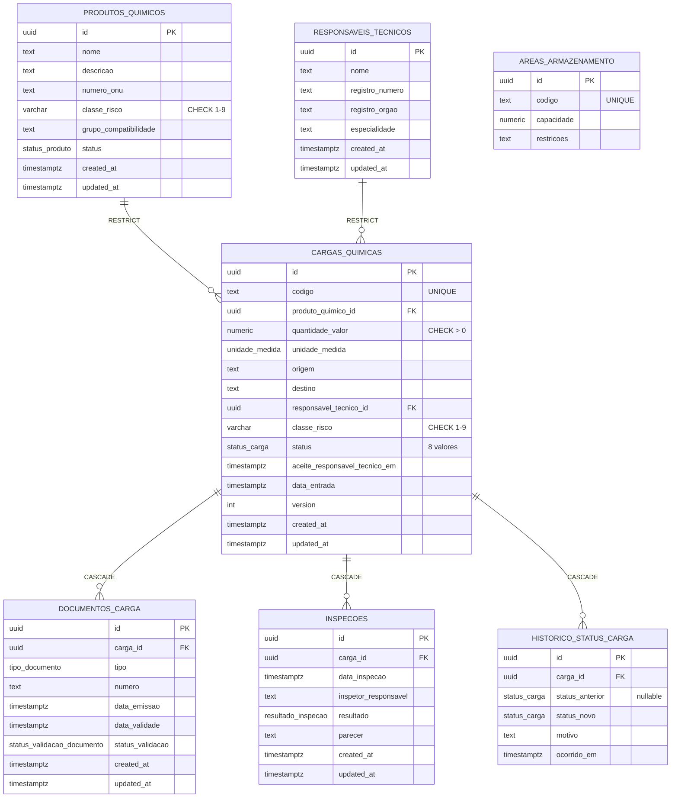

# Diagrama de Entidades e Relacionamentos — Físico (Fase 2)

Este é o ER **físico**: schema real do PostgreSQL, gerado a partir de [`../../prisma/schema.prisma`](../../prisma/schema.prisma). Complementa o [ER conceitual da Fase 1](entidade-relacionamento.md) — ver a diferença entre os dois na seção final daquele documento. Detalhamento de cada coluna em [`../modelagem-de-dados.md`](../modelagem-de-dados.md).

## Diagrama

## Leitura

- As FKs de `CARGAS_QUIMICAS` para `PRODUTOS_QUIMICOS`/`RESPONSAVEIS_TECNICOS` são `ON DELETE RESTRICT`: nunca há exclusão física de produto/RT referenciado (consistente com o domínio nunca fazer hard delete).
- As FKs de `DOCUMENTOS_CARGA`/`INSPECOES`/`HISTORICO_STATUS_CARGA` para `CARGAS_QUIMICAS` são `ON DELETE CASCADE`, espelhando que essas três são, no domínio, partes do agregado `Carga Química` (entidades internas ou histórico) — nunca existem sem uma carga.
- `AREAS_ARMAZENAMENTO` existe como tabela independente, mas ainda sem FK de `CARGAS_QUIMICAS` nesta fase (ver "como os dados podem evoluir" em [`../modelagem-de-dados.md`](../modelagem-de-dados.md)).
- Enums Postgres (`status_produto`, `status_carga`, `unidade_medida`, `tipo_documento`, `status_validacao_documento`, `resultado_inspecao`) garantem, no nível do banco, os conjuntos fechados de valores; `classe_risco` é `VARCHAR(1)` + `CHECK` em vez de enum (ver justificativa em [`../modelagem-de-dados.md`](../modelagem-de-dados.md), seção 5).
