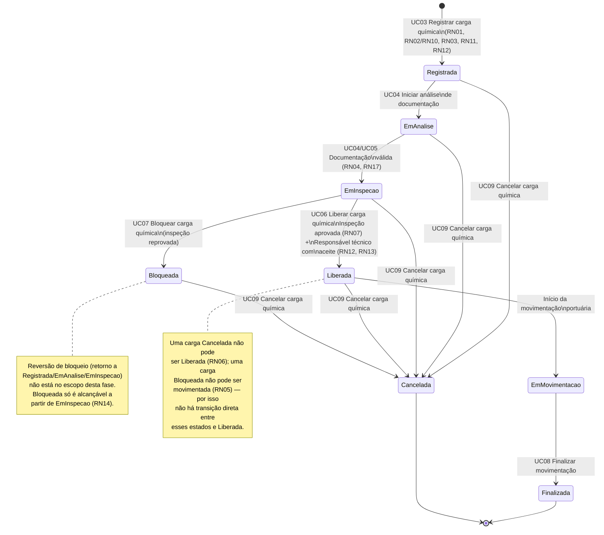

# Fluxo de Transição de Status da Carga Química

> **Histórico de alterações:** revisado na Fase 2 (ver ADR-13 em [`../decisoes-arquiteturais.md`](../decisoes-arquiteturais.md)) — o estado de conferência documental foi renomeado para `EmAnalise`; foram adicionados os estados `EmMovimentacao` e `Finalizada`; `Bloqueada` passou a ser alcançável apenas a partir de `EmInspecao`; `Liberada` deixou de ser terminal (agora segue para `EmMovimentacao`); os terminais passaram a ser exclusivamente `Finalizada` e `Cancelada`.

Diagrama representando o ciclo de vida do status da Carga Química (objeto de valor `StatusCarga`, definido em [`../dominio.md`](../dominio.md) e no [diagrama de domínio](dominio.md)). As transições seguem os casos de uso de [`../casos-de-uso.md`](../casos-de-uso.md) e são condicionadas pelas regras de negócio de [`../regras-de-negocio.md`](../regras-de-negocio.md).

## Estados

| Estado | Significado |
|---|---|
| `Registrada` | Carga criada (UC03), com produto ativo, classificação de risco, quantidade e responsável técnico informados. |
| `EmAnalise` | Documentação obrigatória em conferência (UC04). |
| `EmInspecao` | Documentação validada; carga aguardando ou em processo de inspeção técnica (UC05). |
| `Liberada` | Carga aprovada em todas as validações, apta à movimentação portuária (UC06). |
| `Bloqueada` | Carga impedida de movimentação por descumprimento de regra de negócio/segurança (UC07), somente a partir de `EmInspecao`. |
| `EmMovimentacao` | Carga liberada e em deslocamento físico dentro do porto. |
| `Finalizada` | Movimentação concluída; estado terminal. |
| `Cancelada` | Carga encerrada definitivamente, sem possibilidade de liberação (UC09); estado terminal. |

## Diagrama

## Tabela de transições permitidas (RN14)

Exatamente 11 transições são permitidas; qualquer outro par do produto cartesiano 8×8 (incluindo auto-transições) é proibido (`TRANSICAO_INVALIDA`):

| De | Para | Gate |
|---|---|---|
| Registrada | EmAnalise | — |
| EmAnalise | EmInspecao | Documentação obrigatória completa, válida e não vencida (RN04, RN17) |
| EmInspecao | Liberada | Documentação válida (RN04); inspeção mais recente `Aprovada` (RN07); RT vinculado e com aceite (RN12, RN13) |
| Liberada | EmMovimentacao | — |
| EmMovimentacao | Finalizada | — |
| Registrada | Cancelada | `motivo` obrigatório |
| EmAnalise | Cancelada | `motivo` obrigatório |
| EmInspecao | Cancelada | `motivo` obrigatório |
| Liberada | Cancelada | `motivo` obrigatório |
| Bloqueada | Cancelada | `motivo` obrigatório |
| EmInspecao | Bloqueada | `motivo` obrigatório |

## Leitura do diagrama

O fluxo feliz é `Registrada → EmAnalise → EmInspecao → Liberada → EmMovimentacao → Finalizada`, condicionado pelas regras de gate já detalhadas em [`../regras-de-negocio.md`](../regras-de-negocio.md) (fluxograma de UC06). A partir de `Registrada`, `EmAnalise`, `EmInspecao` ou `Liberada`, uma carga pode ser cancelada (UC09) a qualquer momento. Apenas a partir de `EmInspecao` uma carga pode ser bloqueada (UC07) — por inspeção reprovada ou decisão do Gestor Operacional. `Finalizada` e `Cancelada` são os únicos estados terminais (RN15): nenhuma transição de status, documento, inspeção ou aceite é permitida a partir deles.